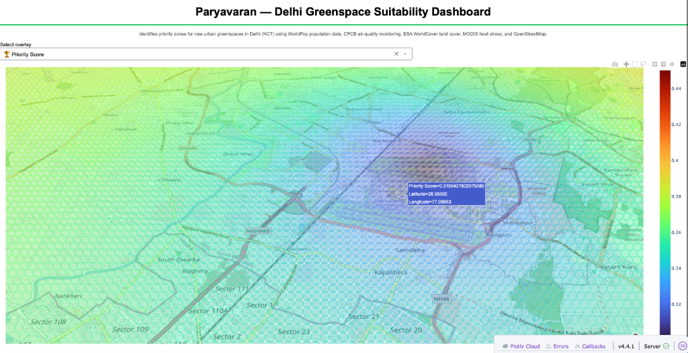
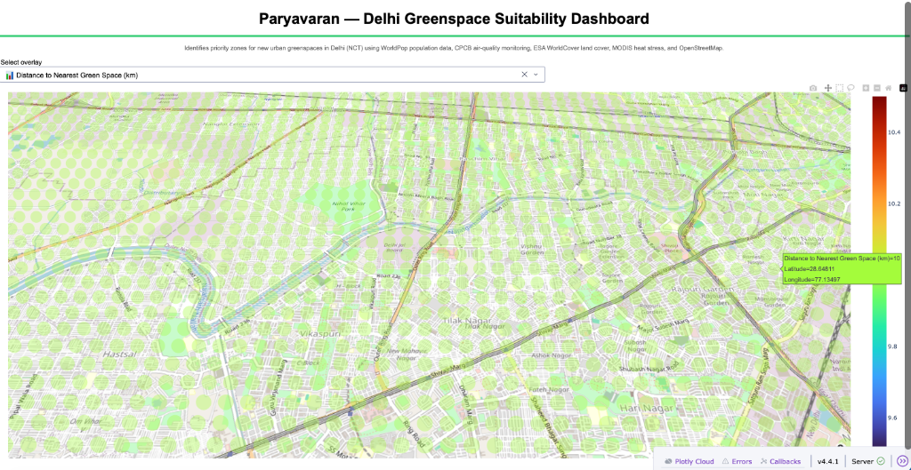
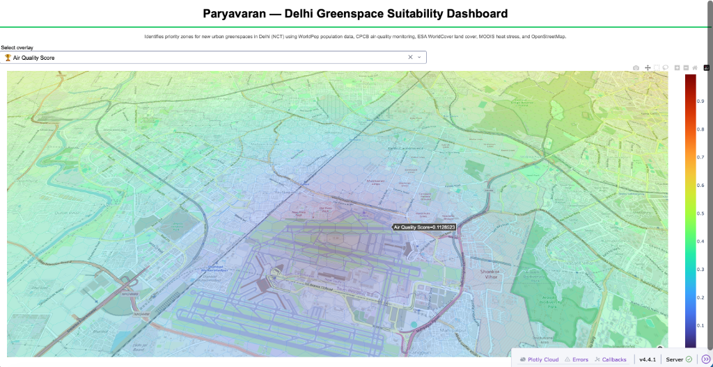

# 🌿 Paryavaran — Delhi Greenspace Suitability Platform

> 🌐 **Live Web Application:** [http://ec2-3-90-145-247.compute-1.amazonaws.com](http://ec2-3-90-145-247.compute-1.amazonaws.com)  
> 📂 **GitHub Repository:** [https://github.com/uselessdevloper/paryavaran](https://github.com/uselessdevloper/paryavaran)  
> 📜 **License:** [MIT License](LICENSE)

---

## 🚀 Key Innovations & Engineering Highlights
1. **Zero-API Open Data Ingestion Engine:** Engineered a high-speed, 100% open-data spatial pipeline ingesting ESA WorldCover (10m), WorldPop India 2024 (100m), OpenStreetMap, and Google Open Buildings without proprietary API barriers.
2. **Ground-Truth Air Quality Telemetry:** Engineered an Inverse Distance-Weighted K-Nearest Neighbors (KNN) spatial interpolation model using ground-truth telemetry from Central Pollution Control Board (CPCB) stations across Delhi for $\text{PM}_{2.5}$, $\text{PM}_{10}$, and $\text{NO}_2$.
3. **Thermal Heat Stress & Structural Congestion Modeling:** Integrated NASA MODIS summer land surface temperature (LST) thermal bands and Google Open Buildings footprints to map micro-urban heat islands (UHI) and high-density built structures.
4. **6-Component Multi-Criteria Suitability Model:** Formulated an urban greenspace suitability equation evaluating heat stress, particulate air pollution, demographic exposure, greenspace deficit, road accessibility, and structural density.
5. **Rule-Based Land Feasibility & Civic Zoning Multipliers:** Implemented realistic planning constraints that strictly exclude airport runways and water bodies ($0.0\times$), penalize hospitals and schools, and actively reward bare/vacant urban land ($1.4\times$).
6. **Vectorized High-Performance Geospatial Engine:** Re-architected spatial intersections with `geopandas.sjoin` and Scikit-Learn `BallTree` in Haversine metric space, reducing grid processing time across 42,300 zones from over 4 hours to under 90 seconds.
7. **Cloud-Native AWS Production Deployment:** Created an automated AWS CloudFormation template (`aws-deploy.yaml`) utilizing SSM Parameter Store for dynamic AMI resolution, running an auto-restarting Systemd daemon and Gunicorn WSGI server on Amazon Linux 2023.

---

## 💡 Inspiration
Over **56% of the world’s population lives in cities today**, a figure projected to approach **70% by 2050**. Few places on Earth illustrate the acute tensions of hyper-urbanization more starkly than **Delhi (National Capital Territory)**. 

Every winter, hazardous smog episodes drive $\text{PM}_{2.5}$ and $\text{PM}_{10}$ concentrations **15 to 25 times above WHO safe limits**. In summer, severe Urban Heat Island (UHI) effects push localized surface temperatures past $45^\circ\text{C}$.

Scientific research confirms that strategically placed urban greenspaces, tree corridors, and Miyawaki micro-forests lower local ambient temperatures by $3^\circ\text{C}$ to $5^\circ\text{C}$, filter particulate matter, buffer stormwater, and restore public health. However, municipal authorities lack unified, high-resolution spatial decision-support tools. Planners face a critical question: **Where should new green infrastructure be prioritized to maximize human health without conflicting with critical civic infrastructure?**

**Paryavaran** provides that decision engine.

---

## 📊 Overview & Dashboard Views

Paryavaran evaluates **42,300 spatial micro-zones** across Delhi NCT on a **250-meter equidistant grid**.

The final dashboard aggregates the underlying data into a **Priority Score** that summarizes where potential greenspaces would most benefit the urban conditions of Delhi. Below is a high-resolution view of the dashboard priority score in the Indira Gandhi International Airport region, showing how the algorithm dynamically highlights critical necessity zones while excluding runways.

<div align="center">
  
  <p><em><strong>Figure 1. Priority Score Map:</strong> Deep blue/colored regions highlight optimal locations for new green infrastructure based on heavily weighted environmental and demographic urgency.</em></p>
</div>

<div align="center">
  
  <p><em><strong>Figure 2. Greenspace Deficit Map:</strong> Red/Orange areas indicate neighborhoods that are severely geographically isolated from existing parks.</em></p>
</div>

<div align="center">
  
  <p><em><strong>Figure 3. Air Quality Deficit Map:</strong> Displays spatial interpolation of CPCB nodes using K-Nearest Neighbor algorithms, highlighting micro-zones with dangerous PM2.5 and NO2 concentrations.</em></p>
</div>

---

## 🧮 Mathematical & Algorithmic Framework

### 1. Geodesic Grid Discretization
We bounded Delhi NCT ($28.40^\circ\text{N}$ to $28.88^\circ\text{N}$, $76.84^\circ\text{E}$ to $77.35^\circ\text{E}$) and discretized it into a uniform grid with spacing $d = 0.25\text{ km}$ ($250\text{ m}$). Geodesic distances along spherical coordinates were calculated using the **Haversine formula**:

$$d = 2R \arcsin \left( \sqrt{\sin^2\left(\frac{\Delta \phi}{2}\right) + \cos(\phi_1)\cos(\phi_2)\sin^2\left(\frac{\Delta \lambda}{2}\right)} \right)$$

where $\phi$ is latitude, $\lambda$ is longitude, and $R \approx 6,371\text{ km}$.

### 2. Spatial Air Quality Interpolation
To estimate localized exposure across every unmonitored grid centroid $p$, we implemented an **Inverse Distance-Weighted K-Nearest Neighbors (KNN)** model across official CPCB monitoring nodes:

$$\hat{Z}(p) = \frac{\sum_{i=1}^{k} w_i Z(s_i)}{\sum_{i=1}^{k} w_i}, \quad \text{where } w_i = \frac{1}{\text{dist}(p, s_i)^2}$$

The interpolated pollutant values were normalized against National Ambient Air Quality Standards (NAAQS) to establish an **Air Quality Deficit Score ($AQ_{\text{score}} \in [0, 1]$)**.

### 3. Multi-Criteria Priority Formulation
The baseline demand for green infrastructure is modeled as a weighted linear combination of environmental urgency and demographic exposure:

$$\text{Raw Priority} = 0.25 \cdot P_{\text{need}} + 0.20 \cdot G_{\text{deficit}} + 0.20 \cdot H_{\text{stress}} + 0.15 \cdot AQ_{\text{score}} + 0.10 \cdot A_{\text{deficit}} + 0.10 \cdot B_{\text{density}}$$

- **$P_{\text{need}}$ (Population Need — 25%):** Normalized WorldPop density amplified in zones failing WHO accessibility benchmarks.
- **$G_{\text{deficit}}$ (Greenspace Deficit — 20%):** Binary deficit indicator ($1.0 - \text{Existing Green Space}$).
- **$H_{\text{stress}}$ (Heat Stress — 20%):** Normalized summer land surface temperature from NASA MODIS.
- **$AQ_{\text{score}}$ (Air Pollution Deficit — 15%):** Distance-weighted particulate exposure index.
- **$A_{\text{deficit}}$ (Accessibility Deficit — 10%):** Distance to nearest park, saturated at $5\text{ km}$:
  $$A_{\text{deficit}} = \min\left(\frac{\text{dist}_{\text{nearest}} + 1.0}{5.0}, \, 1.0\right)$$
- **$B_{\text{density}}$ (Building Footprint Density — 10%):** Structural footprint from Google Open Buildings V3.

### 4. Ground-Truth Feasibility Multipliers
Theoretical necessity must conform to practical urban zoning. We introduced a **Land Feasibility Multiplier ($F$)**:

$$\text{Final Priority Score} = \text{Raw Priority} \times \prod_{j} f_j$$

| Land / Infrastructure Type | Multiplier ($f_j$) | Planning Rationale |
| :--- | :---: | :--- |
| **Airport / Runways** | **$0.00$** | **Absolute exclusion:** Hard flight safety and FAA/DGCA bird strike clearance zones. |
| **Water Bodies** | **$0.00$** | **Absolute exclusion:** Natural water bodies must be preserved, not filled. |
| **Hospitals / Healthcare** | **$0.30$** | Heavy penalty due to existing emergency and building infrastructure. |
| **Schools / Educational** | **$0.40$** | Heavy penalty; limited to small internal playgrounds/gardens. |
| **Railways / Metro Corridors** | **$0.50$** | Restricted track right-of-way; suitable only for narrow buffer planting. |
| **Existing Green Space** | **$0.50$** | Penalized so new funding prioritizes ungreened neighborhoods. |
| **Wetlands** | **$0.60$** | Partial suitability for ecological preservation/flood-buffer zones. |
| **Cropland** | **$0.80$** | Agricultural zoning; limited urban repurposing. |
| **General Open Land** | **$1.00$** | Standard neutral suitability. |
| **Bare / Vacant Land** | **$1.40$** | **Bonus reward:** Premier prime candidate for immediate micro-forest creation. |

---

## ☁️ AWS Architecture & Cloud Deployment

Paryavaran is deployed on **Amazon Web Services (AWS)** using an automated, reproducible **Infrastructure as Code (IaC)** pipeline:

```
                  ┌───────────────────────────────────────────────┐
                  │                 AWS Cloud                     │
                  │                                               │
   User / Browser │   Amazon VPC (Security Group: Port 80 Open)   │
         │        │   ┌────────────────────────────────────────┐  │
         │ HTTP   │   │         Amazon EC2 (t3.medium)         │  │
         └────────┼──►│  Amazon Linux 2023 (AL2023)            │  │
             :80  │   │  ├── Cloud-init (Automated Bootstrapping)│
                  │   │  ├── Systemd Daemon (paryavaran.service)│
                  │   │  └── Gunicorn WSGI ──► Plotly Dash App │  │
                  │   └────────────────────────────────────────┘  │
                  │                       ▲                       │
                  │   AWS CloudFormation ─┴─ SSM Parameter Store  │
                  └───────────────────────────────────────────────┘
```

- **AWS CloudFormation (`aws-deploy.yaml`):** Declaratively models and provisions the entire infrastructure (EC2, security groups, public IP mapping).
- **AWS Systems Manager (SSM) Parameter Store:** Dynamically resolves the latest official Amazon Linux 2023 AMI (`resolve:ssm:/aws/service/ami-amazon-linux-latest/al2023-ami-kernel-default-x86_64`) without hardcoded region strings.
- **Amazon EC2 (`t3.medium`):** Provides 2 vCPUs and 4 GB RAM to perform vector serialization and instant client responses across 42,000+ spatial points.
- **Amazon VPC & Security Groups:** Enforces least-privilege network perimeter security, allowing ingress traffic strictly on TCP port 80.
- **Gunicorn + Systemd:** Configured as a managed background service (`paryavaran.service`) with auto-restart, health-monitoring, and boot-time stdout/stderr piped to `/dev/console`.

---

## 🛠️ Project Structure & Data Pipeline

```
Paryavaran/
├── LICENSE                       ← Open-source MIT License
├── aws-deploy.yaml               ← AWS CloudFormation IaC deployment template
├── requirements.txt              ← Full spatial processing dependencies
├── requirements-web.txt          ← Lightweight production web dependencies (EC2)
├── helpers.py                    ← Core feature engineering + scoring formulation
├── Enums/
│   └── land_type.py              ← Land type classification enums
├── Notebooks/
│   ├── create_penultimate_df.ipynb
│   └── create_final_df.ipynb
├── Scripts/
│   └── build_land_type_csv.py    ← Grid generation + raster sampling + OSM joins
├── Plotly_Dash_App/
│   └── app.py                    ← Interactive Dash web application
├── Dashboard_Images/             ← High-resolution dashboard screenshots
├── final_df.csv                  ← Pre-computed scored dataset (single source of truth)
└── points_df_025.csv             ← 250m Delhi grid coordinates
```

---

## 💻 Local Setup & Reproducibility Guide

### 1. Install Dependencies
```bash
pip install -r requirements.txt
```

### 2. Prepare Data Files
Place raw rasters and vector files in a `Data/` directory:
- `worldpop_india_2024_100m.tif` ([WorldPop India 2024](https://hub.worldpop.org/geodata/summary?id=50771))
- `worldcover_delhi.tif` ([ESA WorldCover 10m](https://esa-worldcover.org/en/data-access))
- `modis_lst_summer_mean.tif` ([NASA LP DAAC MOD11A2](https://lpdaac.usgs.gov/))
- `open_buildings_delhi.gpkg` ([Google Open Buildings](https://sites.research.google/gr/open-buildings/))
- `cpcb_stations.csv` ([CPCB Air Quality Portal](https://www.data.gov.in/catalog/real-time-air-quality-index))

*Note: OpenStreetMap road, park, water, and infrastructure polygons are fetched dynamically during script execution via `osmnx`.*

### 3. Run Pipeline
```bash
# Step 1: Generate 250m grid and sample rasters/vectors
python Scripts/build_land_type_csv.py

# Step 2: Compute KNN air quality and distance matrices
jupyter nbconvert --to notebook --execute Notebooks/create_penultimate_df.ipynb

# Step 3: Compute priority scores and feasibility multipliers
jupyter nbconvert --to notebook --execute Notebooks/create_final_df.ipynb

# Step 4: Launch local dashboard
cd Plotly_Dash_App
python app.py
```
Visit `http://127.0.0.1:8050` in your browser.

---

## 🎯 UN Sustainable Development Goals (SDGs) Met
- **SDG 3 (Good Health and Well-Being):** Targeted mitigation of toxic PM2.5 hotspots and lethal summer heat stress.
- **SDG 10 (Reduced Inequalities):** Directly addresses "greenspace inequality" by directing public resources to underserved informal settlements rather than already-green affluent enclaves.
- **SDG 11 (Sustainable Cities and Communities):** Equips municipal authorities with data-driven zoning intelligence to preserve biodiversity and expand urban tree canopy.
- **SDG 13 (Climate Action):** Directly counters the Urban Heat Island effect and supports natural carbon sequestration.
- **SDG 15 (Life on Land):** Fosters micro-ecosystems and urban biodiversity corridors amidst concrete density.

---

## 📜 Data Sources & Licensing

### Dataset Attributions
- **WorldPop:** CC BY 4.0, University of Southampton
- **ESA WorldCover:** CC BY 4.0, European Space Agency / VITO
- **OpenStreetMap:** Open Database License (ODbL), OpenStreetMap contributors
- **Google Open Buildings V3:** CC BY 4.0 / ODbL, Google Research
- **NASA MODIS LST:** NASA LP DAAC, Public Domain
- **CPCB Air Quality:** Central Pollution Control Board, Government of India Open Government Data (OGD)

### Code License
This project is licensed under the **[MIT License](LICENSE)**.
